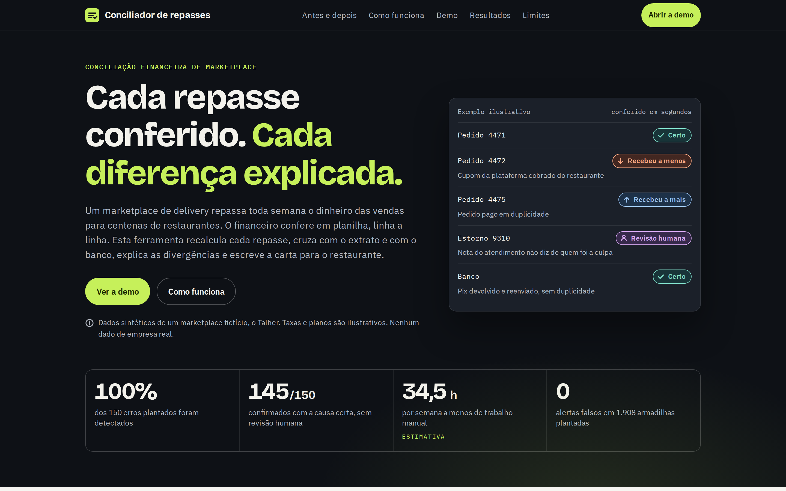
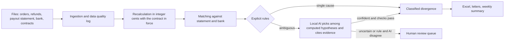

# Conciliador de repasses

*Leia em [português](README.pt-BR.md).*

A tool that reconciles the weekly payouts a food delivery marketplace makes to restaurants. It recalculates what each order should pay, matches it against the payout statement and the bank statement, finds every divergence, explains the cause, writes the letter to the restaurant and builds the report for the finance team.

The AI runs on your own machine, never does arithmetic, and every text it writes is checked before anyone reads it. Whatever it cannot settle with confidence goes to a human review queue.



**Site:** [andreilud.github.io/conciliador-de-repasses](https://andreilud.github.io/conciliador-de-repasses/) (GitHub Pages, from `docs/`). **Local app:** `streamlit run app/streamlit_app.py`.

> Synthetic data. Talher is a fictitious marketplace; restaurants, tax ids, fees and plans are illustrative. The site, letters and app are in Brazilian Portuguese.

## Results

<!-- facts -->
| Metric | Result |
|---|---|
| Planted errors detected (recall) | 100.0% of 150 |
| Confirmed automatically with the right cause | 145 of 150 (96.7%) |
| Precision of confirmed divergences | 100.0% |
| False alarms on traps | 0 of 1908 |
| Cases in the human review queue | 18 |
| Money found: restaurants underpaid | R$ 3.380,11 |
| Money found: restaurants overpaid | R$ 20.012,31 |
| Hours saved per week (estimate) | 34.5 h (37.6 h in spreadsheets vs 3.1 h) |
| Time to reconcile the month, rules only | 9 s |
| API cost | R$ 0 (local model) |
| Ambiguous cases, rules only | 33 right, 7 wrong and 28 sent to review, of 68 |
| Ambiguous cases, rules and local AI | 50 right, 0 wrong and 18 sent to review, of 68 |

Numbers come from `docs/data/facts.json`, written by `python run_all.py`. The rules versus AI comparison on ambiguous cases is in `project_docs/evaluation.md` (Portuguese).
<!-- /facts -->

## The problem

Every week the marketplace pays restaurants their sales minus commission, payment fees, coupons and refunds. Finance has to check that each payout is right, find the differences, figure out why and explain them to the restaurant. Today that happens in spreadsheets, line by line.

## How it works



| Step | Who decides |
|---|---|
| Parsing, cleaning, recalculation, matching, detection, amounts | Rules, in SQL (DuckDB) and Python |
| Cause when only one hypothesis explains the amount | Rules |
| Cause when the evidence is free text or two hypotheses fit | Local AI, validated |
| Uncertain cases | A person, through the review queue |
| Letter to the restaurant and weekly summary | Code. The AI was tested for these texts and turned off: in a human review of 20 letters, 12 had a wrong or invented fact (`project_docs/revisao_cartas_ia.csv`) |

**The AI never does arithmetic.** Money is integer cents and rates are basis points; no floating point. Every model answer is JSON validated with a schema. Every number the model writes must exist in the data. Citing evidence that does not exist rejects the answer.

## Synthetic data with an answer key

There is no public payout data, so the project ships a seeded generator (`src/generator/`): 200 restaurants, one month of orders, payout statements in two layouts, a Brazilian bank statement and contracts in Excel. Ten error types are planted with an answer key, plus traps that look wrong but are right. See `project_docs/data_dictionary.md` and `project_docs/methodology.md` (Portuguese).

## Local AI

| Provider | Variable | Use |
|---|---|---|
| llama.cpp (`llama-server`) or LM Studio | `LLM_PROVIDER=llamacpp` | Local OpenAI compatible server |
| Ollama | `LLM_PROVIDER=ollama` | Local Ollama server |
| Cache | `LLM_MODE=offline` | Replays answers stored in `llm_cache/`, no server needed |

The cache in the repository was produced with Qwen3.5 2B, 4 bit quantized, on a CPU with no GPU. Each run logs tokens and machine time. API cost: zero.

What the test showed: the small model did well reading support notes (no wrong decision on refunds with no owner) and badly writing (wrong facts in letters and summaries, even without numbers). The published version therefore uses the AI only to classify. `LETTERS_AI=1` and `SUMMARY_AI=1` turn writing back on to test a larger model.

## Reproduce

```bash
python -m venv .venv && source .venv/bin/activate
pip install -r requirements.txt
cp .env.example .env
python run_all.py --offline   # everything, replaying the AI cache (no model needed)
python run_all.py --ai off    # rules only
python run_all.py             # with the local model on (see below)
python -m pytest
python -m src.export.check_texts
```

Or `make offline`, `make all`, `make test`.

### With the local model

Ollama:

```bash
ollama pull qwen3.5:2b
LLM_PROVIDER=ollama LLM_BASE_URL=http://127.0.0.1:11434 LLM_MODEL=qwen3.5:2b python run_all.py
```

llama.cpp server, the same one used to build the cache (put the Qwen3.5 2B Q4_K_M GGUF file in `models/`):

```bash
docker compose --profile llamacpp up -d llamacpp
python run_all.py
```

Changing the model changes the cache key: new answers are generated and stored in `llm_cache/`.

## Local app (Streamlit)

```bash
streamlit run app/streamlit_app.py
```

Upload the six files (or use the sample data), reconcile, review divergences, the review queue, letters and the data quality log, then download the Excel report and the letters. With Docker: `docker compose up app`, then open `http://localhost:8501`.

## GitHub Pages

The site is static, lives in `docs/` and only reads small JSON files from `docs/data/`. It calls no API.

1. On GitHub, open **Settings**, then **Pages**.
2. Under **Build and deployment**, choose **Deploy from a branch**.
3. Pick branch **main** and folder **/docs**, then save.

After a few minutes the site is live at https://andreilud.github.io/conciliador-de-repasses/. Locally: `cd docs && python -m http.server 8000`.

## Limitations

* Errors were planted by the same person who wrote the engine. The metrics show the rules work, not that they cover real world errors. With real data, the first step is to run in parallel with the spreadsheet for a few weeks.
* The local model is small and slow on an ordinary CPU. It only picks among options, and everything goes through checks. Letters and summaries are written by code, because the model got facts wrong.
* A refund with no owner that was already deducted is accepted as correct. With real data, those deserve an audit too.
* Automatic letters need human review before sending.

## Layout

```
├── run_all.py            one command runs everything
├── src/                  generator, ingestion, reconciliation, llm, evaluation, export
├── sql/                  one stage per file, each with a header comment
├── prompts/              system prompts, in Portuguese
├── llm_cache/            model answers, versioned
├── app/                  Streamlit app
├── tests/                pytest
├── docs/                 static site (GitHub Pages)
├── project_docs/         brief, data dictionary, quality log, methodology, evaluation, demo script
└── data/                 raw and interim (ignored), processed, answer_key
```

## License

MIT. See `LICENSE`. The fonts in `docs/vendor/fonts` are under the SIL Open Font License.
