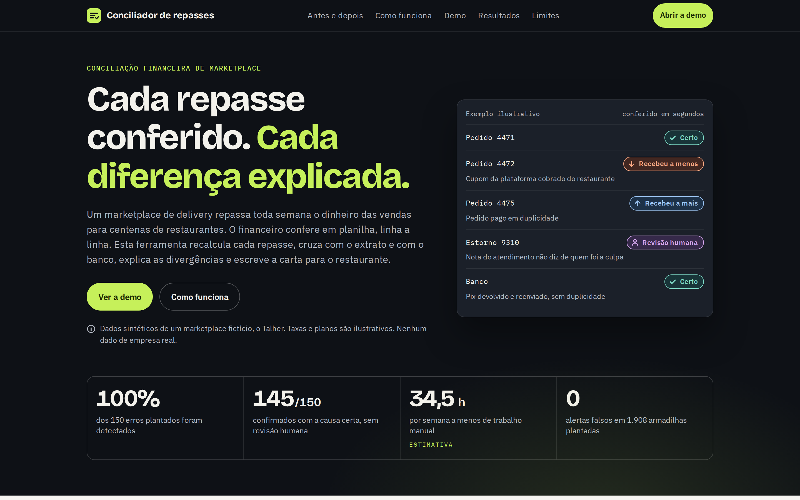
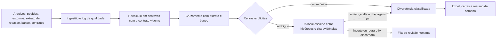

# Conciliador de repasses

*Read in [English](README.md).*

Ferramenta que confere o repasse semanal de um marketplace de delivery para os restaurantes. Ela recalcula o valor devido de cada pedido, cruza com o extrato de repasse e com o extrato do banco, encontra cada divergência, explica a causa, escreve a carta para o restaurante e gera o relatório para o financeiro.

A IA roda na máquina, nunca faz conta e passa por checagens antes de qualquer texto chegar a alguém. O que ela não resolve com segurança vai para uma fila de revisão humana.



**Site:** [andreilud.github.io/conciliador-de-repasses](https://andreilud.github.io/conciliador-de-repasses/) (GitHub Pages, a partir de `docs/`). **App local:** `streamlit run app/streamlit_app.py`.

> Dados sintéticos. O Talher é um marketplace fictício; restaurantes, CNPJs, taxas e planos são ilustrativos.

## Resultados

<!-- facts -->
| Métrica | Resultado |
|---|---|
| Erros plantados detectados (revocação) | 100,0% dos 150 |
| Confirmados automaticamente com a causa certa | 145 de 150 (96,7%) |
| Precisão das divergências confirmadas | 100,0% |
| Alertas falsos nas armadilhas | 0 de 1.908 |
| Casos na fila de revisão humana | 18 |
| Dinheiro achado: restaurantes receberam a menos | R$ 3.380,11 |
| Dinheiro achado: restaurantes receberam a mais | R$ 20.012,31 |
| Horas por semana economizadas (estimativa) | 34,5 h (37,6 h na planilha contra 3,1 h) |
| Tempo para conciliar o mês só com regras | 9 s |
| Custo de API | R$ 0 (modelo local) |
| Casos ambíguos, só regras | 33 certos, 7 errados e 28 na revisão, de 68 |
| Casos ambíguos, regra e IA local | 50 certos, 0 errados e 18 na revisão, de 68 |

Os números vêm de `docs/data/facts.json`, escrito por `python run_all.py`. A comparação entre regra e IA nos casos ambíguos está em `project_docs/evaluation.md`.
<!-- /facts -->

## O problema

Toda semana o marketplace repassa aos restaurantes o valor das vendas, descontando comissão, taxa de pagamento, cupons e estornos. O financeiro precisa conferir se o valor bate, achar as diferenças, descobrir a causa e explicar ao restaurante. Na planilha, isso é feito linha a linha.

## Como funciona



| Etapa | Quem decide |
|---|---|
| Leitura, limpeza, recálculo, cruzamento, detecção, valores | Regra, em SQL com DuckDB e Python |
| Causa quando só uma hipótese explica o valor | Regra |
| Causa quando a evidência é texto livre ou duas hipóteses explicam o valor | IA local, com validação |
| Casos incertos | Pessoa, pela fila de revisão |
| Carta ao restaurante e resumo da semana | Código. A IA foi testada para escrever esses textos e ficou desligada: numa revisão humana de 20 cartas, 12 tinham fato errado ou inventado (`project_docs/revisao_cartas_ia.csv`) |

**A IA não faz conta.** Dinheiro em centavos inteiros e taxas em pontos-base, sem ponto flutuante. Toda resposta do modelo é JSON validado por schema. Todo número que o modelo escreve precisa existir nos dados. Evidência citada que não existe derruba a resposta.

## Dados sintéticos com gabarito

Não existem dados públicos de repasse, então o projeto traz um gerador com semente fixa (`src/generator/`): 200 restaurantes, um mês de pedidos, extrato de repasse em dois layouts, extrato bancário no formato brasileiro e contratos em Excel. Dez tipos de erro são plantados com gabarito, junto com armadilhas que parecem erro e não são. Detalhes em `project_docs/data_dictionary.md` e `project_docs/methodology.md`.

## IA local

| Provedor | Variável | Uso |
|---|---|---|
| llama.cpp (`llama-server`) ou LM Studio | `LLM_PROVIDER=llamacpp` | Servidor local compatível com a API do OpenAI |
| Ollama | `LLM_PROVIDER=ollama` | Servidor local do Ollama |
| Cache | `LLM_MODE=offline` | Repete as respostas gravadas em `llm_cache/`, sem servidor |

O cache que acompanha o repositório foi gerado com o Qwen3.5 2B quantizado em 4 bits, rodando em CPU sem placa de vídeo. Cada execução registra tokens e tempo de máquina. Custo de API: zero.

O que o teste mostrou: o modelo pequeno foi bem ao ler a nota do atendimento (nenhuma decisão errada nos estornos sem responsável) e mal ao escrever (fatos errados em cartas e resumos, mesmo sem números). Por isso a versão publicada usa a IA só para classificar. `LETTERS_AI=1` e `SUMMARY_AI=1` religam a escrita para testar um modelo maior.

## Como reproduzir

```bash
python -m venv .venv && source .venv/bin/activate
pip install -r requirements.txt
cp .env.example .env
python run_all.py --offline   # tudo, repetindo o cache da IA (não precisa de modelo)
python run_all.py --ai off    # só regras
python run_all.py             # com o modelo local ligado (veja abaixo)
python -m pytest              # testes
python -m src.export.check_texts
```

Ou `make offline`, `make all`, `make test`.

### Com o modelo local

Ollama:

```bash
ollama pull qwen3.5:2b
LLM_PROVIDER=ollama LLM_BASE_URL=http://127.0.0.1:11434 LLM_MODEL=qwen3.5:2b python run_all.py
```

Servidor do llama.cpp, o mesmo usado para gerar o cache (baixe o arquivo GGUF do Qwen3.5 2B Q4_K_M para `models/`):

```bash
docker compose --profile llamacpp up -d llamacpp
python run_all.py
```

Trocar de modelo muda a chave do cache: as respostas novas são geradas e gravadas em `llm_cache/`.

## App local (Streamlit)

```bash
streamlit run app/streamlit_app.py
```

Sobe os seis arquivos (ou usa os dados de exemplo), concilia, mostra divergências, fila de revisão, cartas e log de qualidade, e baixa o Excel e as cartas. Com Docker: `docker compose up app` e abra `http://localhost:8501`.

## Site no GitHub Pages

O site é estático, fica em `docs/` e lê só arquivos JSON leves de `docs/data/`. Não chama nenhuma API.

1. No GitHub, abra **Settings**, depois **Pages**.
2. Em **Build and deployment**, escolha **Deploy from a branch**.
3. Selecione a branch **main** e a pasta **/docs**. Salve.

Depois de alguns minutos, o site fica em https://andreilud.github.io/conciliador-de-repasses/. Para ver localmente: `cd docs && python -m http.server 8000`.

## Limitações

* Os erros foram plantados por quem escreveu o motor. As métricas mostram que as regras funcionam, não que cobrem os erros do mundo real. Com dados reais, o primeiro passo seria rodar em paralelo à planilha por algumas semanas.
* O modelo local é pequeno e lento em CPU comum. Ele só escolhe entre opções, e tudo passa por checagem. Escrever cartas e resumos ficou com o código, porque o modelo errava fatos.
* Um estorno sem responsável que já foi descontado é aceito como correto. Com dados reais, valeria auditar também esses casos.
* Cartas automáticas exigem revisão humana antes do envio.

## Estrutura

```
├── run_all.py            um comando roda tudo
├── src/                  generator, ingestion, reconciliation, llm, evaluation, export
├── sql/                  uma etapa por arquivo, com comentário no topo
├── prompts/              prompts do sistema em português
├── llm_cache/            respostas do modelo, versionadas
├── app/                  app em Streamlit
├── tests/                pytest
├── docs/                 site estático (GitHub Pages)
├── project_docs/         brief, dicionário de dados, log de qualidade, metodologia, avaliação, roteiro do vídeo
└── data/                 raw e interim (ignorados), processed, answer_key
```

## Licença

MIT. Veja `LICENSE`. As fontes em `docs/vendor/fonts` seguem a SIL Open Font License.
